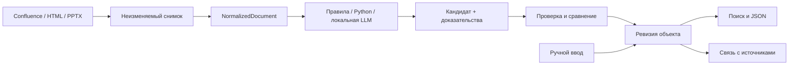

# План реализации Architecture Registry Studio

**Дата:** 27 октября 2026. **Статус:** план принят; ручной реестр, HTML, Confluence, PPTX и правила/Python реализованы. Фактическое покрытие и ограничения: [progress.md](progress.md), проверки: [verification.md](verification.md), [Confluence](confluence.md). Реальный доступ к Confluence ещё не проверен.

> **For agentic workers:** REQUIRED SUB-SKILL: Use superpowers:executing-plans to implement this plan task-by-task. Steps use checkbox (`- [ ]`) syntax for tracking. Авторизованы ручной реестр, HTML и Confluence 7.13.7 on-premise с PAT. Дополнительно авторизованы и реализованы PPTX и редактор правил/Python (уточнение пользователя 27.10). Этап Ollama и семантического поиска дополнительно авторизован пользователем и реализован в0.4.

**Goal:** локальное приложение для одного пользователя, превращающее Confluence, HTML, PPTX и ручной ввод в проверяемые объекты архитектурных реестров.

**Architecture:** модульный Python backend обслуживает интерфейс в браузере и локальное API; отдельный локальный worker выполняет устойчивую очередь заданий. SQLite хранит реестр и журнал, файловое хранилище — неизменяемые снимки источников. Машинное извлечение создаёт предложения; подтверждение пользователя создаёт ревизию объекта.

**Tech Stack (предложение):** Python, FastAPI, Pydantic, SQLAlchemy/Alembic, SQLite/FTS5, lxml, python-pptx, jsonschema; React/TypeScript/Vite; pytest и Playwright. Ollama и контейнерный исполнитель Python подключаются на поздних этапах. Точные версии фиксируются lock-файлами при реализации.

**Spec:** [первичный анализ](problem_analize.md) и уточнение пользователя: «Локальное приложение для одного пользователя».

## 1. Решения и границы

Сейчас в проекте есть только исходный анализ, готовых модулей и тестов нет. Архитектура и пути ниже проектируемые, а не описание существующего кода.

| Вариант | Преимущества | Цена | Решение |
|---|---|---|---|
| Локальный веб-интерфейс + Python + SQLite | Простая установка, подходящая среда для парсеров, автономная работа с сохранёнными данными | Нужно управлять жизненным циклом локального сервиса | Рекомендован для первой версии |
| Настольная оболочка + тот же Python backend | Единое окно и интеграция с ОС | Дополнительная упаковка, обновления, IPC | После проверки основных сценариев |
| Командный сервис + PostgreSQL + очередь | Совместная работа, централизованные права | Сервер, учётные записи, эксплуатация | При появлении нескольких пользователей |

Выбор локального режима подтверждён пользователем; конкретный стек и способ упаковки — предложения этого плана.

**Первый полезный выпуск:** ручной ввод, один согласованный тип объекта, HTML, Confluence CQL и таблицы, кандидаты, проверка источника, повторный импорт, поиск по словам, JSON-экспорт, резервное копирование.

**Полный объём запроса:** дополнительно PPTX, редактор правил, пользовательский Python, локальная LLM и семантический поиск. Это обязательные последующие выпуски, а не исключённые требования.

В первую версию не входят: OCR изображений, интерпретация графических схем/SmartArt, многопользовательский доступ, автоматическое изменение Confluence, произвольные языки скриптов, универсальный графический DAG-редактор. Для пользовательского кода первым языком выбран Python.

### Global Constraints

- Основная платформа — Windows; UI на русском; сервис слушает только `127.0.0.1`.
- Обычный импорт не требует Docker, Redis, PostgreSQL или LLM.
- Работа с сохранёнными документами, реестром и экспортом доступна без сети.
- Ни скрипт, ни LLM, ни повторная загрузка не изменяют утверждённый объект напрямую.
- Каждый объект имеет UUID, ревизию и закреплённую версию схемы.
- Каждое машинное предложение содержит ссылку на снимок и фрагмент либо явную отметку отсутствия доказательства.
- Никаких секретов в пайплайнах, JSON-экспорте, журналах и диагностических архивах.
- Бинарные файлы и БД находятся вне репозитория, по умолчанию `%LOCALAPPDATA%/ArchitectureRegistryStudio/`.

### Review Focus

1. Две вкладки принимают разные предложения к одной ревизии: второе подтверждение получает конфликт, а не затирает первое (задача 3).
2. Страница переименована, пропала из CQL или недоступна: UUID объекта сохраняется, реестр не удаляется (задача 4).
3. Маркер встречается внутри абзаца, таблицы вложены, ячейки объединены: извлечение не обрезает текст молча и сохраняет координаты (задача 2).
4. Приложение закрыто между сохранением результата и завершением задания: после запуска нет дублирующих объектов и кандидатов (задача 4).
5. Презентация содержит только изображения, LLM придумала цитату или скрипт завис: видимый диагностический результат вместо ложного успешного извлечения (задачи 6–8).

## 2. Сквозной поток



Пользователь задаёт источник, фильтр CQL и пайплайн, видит найденные страницы и запускает импорт. Отдельный результат сохраняется для каждой страницы. Ошибка одного документа не останавливает всю выборку. На экране проверки слева исходный фрагмент, справа поля и причины предложений. Можно принять поле, исправить, оставить текущее значение или отклонить предложение. Сохранение черновика допускает неполные поля; публикация требует успешной валидации.

PPTX, указанный ссылкой на странице, по умолчанию дополняет объект страницы. Создание самостоятельного объекта из вложения — явный выбор другого профиля. Привязка страницы к ручному объекту сама по себе не запускает изменение реквизитов.

## 3. Данные и непротиворечивое обновление

| Сущность | Основные поля и ограничения |
|---|---|
| ArtifactTypeVersion | `type_id`, `version`, JSON Schema; опубликованная версия неизменяема |
| Artifact / ArtifactRevision | UUID, тип, текущая ревизия; неизменяемые значения и статусы в истории |
| Source | Вид подключения, base URL, ссылка на секрет в хранилище ОС |
| SourceResource | `source_id`, `external_id`, вид, URL, parent resource; уникальность пары source/external ID |
| SourceSnapshot | resource ID, внешняя версия, SHA-256, путь к содержимому, время получения |
| ImportProfile | Область импорта, тип, cardinality, правила идентичности; стабильный ID при смене версии пайплайна |
| PipelineVersion | Неизменяемые шаги, параметры, хеши кода и промптов |
| ImportRun / ImportItem / StepExecution | Выборка ресурсов, прогресс, попытки, версии зависимостей, ошибки по шагам |
| ArtifactCandidate | target artifact или запрос создания, base revision, предложения полей, статус |
| FieldEvidence | Поле, снимок, block ID, координаты, цитата, метод, шаг, параметры и предупреждения |
| ArtifactSourceLink | artifact/resource, роль primary/supporting; import binding отделён от дополнительной связи |
| ReviewDecision / AuditEvent | Принять, исправить, отклонить, оставить; до/после, время и причина |
| SearchProjection / Embedding | artifact revision, текст, модель и её версия, размерность вектора |

**Идентичность:** в политике `one_per_page` уникален ключ `(import_profile_id, page_resource_id)`. Смена URL, содержимого или версии пайплайна не меняет этот ключ. Два профиля могут намеренно создавать разные типы из одной страницы; UI предупреждает о существующих связях. Сначала применяется явная связь, затем согласованный бизнес-ключ; неоднозначное совпадение требует выбора. Семантическая близость не даёт права автоматически объединять записи.

**Повторное исполнение:** ключ результата включает профиль, набор снимков, версию пайплайна и схемы. Технический retry возвращает прежний результат. Явная повторная оценка с теми же входами создаёт новый run с `reprocess_nonce`, сохраняя историю; прежние неподтверждённые кандидаты помечаются superseded и не могут быть приняты как актуальные.

**Обновление:** сохранять предыдущий импортированный baseline, текущее утверждённое значение и новое предложение. Это три стороны сравнения. Отдельно хранить ревизию объекта на момент построения кандидата. При подтверждении сравнить `expected_revision` в транзакции: несовпадение → HTTP 409 и повторное сравнение. Ручные значения никогда не теряются автоматически; пустой результат извлечения не означает запрос на очистку поля.

**Схемы:** UI первоначально поддерживает ограниченный профиль JSON Schema: строки, числа, boolean, даты, enum, массивы строк. Неподдерживаемые конструкции отклоняются при создании типа с объяснением. Смена схемы не мигрирует старые объекты автоматически: предварительная проверка → отдельный кандидат миграции → подтверждение.

## 4. Контракты обработки

Контракты определить в `backend/app/contracts.py`; формат JSON версионировать через `contract_version`.

```text
NormalizedDocument(snapshot_id, blocks[], metadata, warnings[])
DocumentBlock(id, kind, parent_id, order, text, table_cells?, source_anchor)
SourceAnchor(snapshot_id, html_path? | slide_index/shape_id?, start?, end?, quote)
FieldProposal(field_path, value, evidence[], warnings[])
StepResult(proposals[], diagnostics[], output_blocks[])
PipelineContext(document, schema, params)   # без БД и секретов
ReviewRequest(candidate_id, expected_revision, decisions[])
```

HTML и Confluence storage имеют отдельные адаптеры в общую модель. Для Confluence сохраняется исходный storage; rendered content при необходимости получает отдельный снимок и привязки. Неизвестные макросы дают предупреждение, а не исчезают незаметно.

В MVP пайплайн — последовательность типизированных шагов в YAML/JSON. Каждый шаг объявляет входы/выходы. Неявное правило «последний перезаписал поле» запрещено: конфликтующие предложения показываются пользователю либо разрешаются явной политикой приоритета. Возобновление выполняется от сохранённого снимка с закреплёнными версиями.

Правило `extract_between` сначала работает по заголовкам/границам блоков. Текстовые маркеры — отдельный режим. Нет стартового/конечного маркера или найдено несколько подходящих диапазонов → предупреждение и отсутствие предложения; выбор диапазона задаётся параметром. Таблица выбирается по заголовкам/подписи/CSS, а не по непроверенному предположению «первая таблица».

Очередь хранится в SQLite: `queued → running → succeeded | failed | cancelled`. Один worker берёт задания с lease и heartbeat, пишет короткими транзакциями; просроченные lease восстанавливаются при запуске. Парсинг и сеть происходят вне транзакций. Внешние ошибки повторяются ограниченно с backoff; ошибки формата не повторяются без изменения входа. Отмена проверяется между шагами; дочерний процесс завершается по timeout.

## 5. Локальное исполнение и защита данных

- Launcher запускает API и worker, открывает браузер, корректно завершает процессы. React build обслуживает backend; Node нужен при сборке, не при работе установленного приложения.
- Для запросов изменения нужен токен локальной сессии; проверять Origin/Host, не разрешать wildcard CORS. Привязка к loopback сама по себе не защищает от чужой веб-страницы.
- Confluence: секрет в Windows Credential Manager через адаптер; доступ только на чтение. Не переносить Authorization при redirect на чужой host. HTML-просмотр санитизируется; оригинал не исполняется, внешние ресурсы не подгружаются.
- На загрузку и распаковку PPTX установить настраиваемые пределы размера, числа ZIP entries и суммарного распакованного объёма; не извлекать пути за пределами рабочей директории.
- Python-скрипты: отдельный одноразовый Linux-контейнер, непривилегированный UID, сеть выключена, root FS read-only, только входной JSON и ограниченный временный каталог; лимиты CPU/RAM/времени/output, без Docker socket, БД и секретов внутри контейнера. Backend передаёт JSON через stdin/stdout.
- Предлагаемые стартовые лимиты скрипта: 30 секунд, 512 MiB RAM, 1 CPU, 10 MiB stdout. Runtime на Windows — Docker Desktop/WSL2 либо совместимый контейнерный runtime, проверяется на этапе 7. Если его нет, скриптовый шаг недоступен с понятной диагностикой; небезопасного fallback через backend `exec` нет.
- Резервирование: остановить приём заданий и дождаться окончания записей; SQLite backup API + все referenced blobs + manifest/checksums. Секреты не включать. Восстановление в пустой каталог проверяет ссылки/хеши и запускает миграции после резервной копии. JSON-экспорт объектов не заменяет backup.

## 6. План работ

Каждая задача заканчивается самостоятельной демонстрацией и проверками. При реализации сначала добавить указанные тесты и увидеть ожидаемый отказ из-за отсутствующей функции, затем код и успешный прогон. Фиксировать изменения отдельными коммитами, если к этому моменту создан Git-репозиторий. Перечисленные ниже команды — будущая проверка, сейчас они не выполнялись.

### Задача 0. Зафиксировать пилотные данные и эксплуатационные условия

**Создать:** `docs/fixtures_manifest.md`, `tests/fixtures/`, `docs/acceptance.md`.

- [ ] Уточнить редакцию/версию Confluence и авторизацию; получить обезличенные примеры страницы, вложения и HTML. Без доступа разработка идёт по fixtures, реальную интеграцию не считать проверенной.
- [ ] Согласовать один реальный тип объекта, обязательные поля, бизнес-ключ и ожидаемые JSON. Пример ADR из анализа не считать утверждённой схемой.
- [ ] Собрать минимум 20 документов с эталонными полями и anchors, включая повреждённые/неоднозначные; выделить закрытую контрольную часть для LLM.
- [ ] Записать объём реестра, характеристики Windows-компьютера и наличие контейнерного runtime/GPU. Отсутствие GPU не блокирует детерминированный MVP.

**Выход:** воспроизводимый набор приёмки и подтверждённый контракт первого типа. Остальные задачи зависят от этого контракта.

### Задача 1. Ручной реестр и локальный запуск

**Создать:** `backend/pyproject.toml`, `backend/app/{main,contracts,db}.py`, `backend/app/registry/{models,service,router}.py`, `backend/migrations/`, `frontend/package.json`, `frontend/src/features/registry/`, `scripts/start.ps1`, `tests/test_registry.py`.

**Интерфейсы:** `create_artifact(type_version_id, fields, status) -> Artifact`; `revise_artifact(id, expected_revision, fields) -> ArtifactRevision`. API: `/api/types`, `/api/artifacts`, `/api/artifacts/{id}/revisions`.

- [ ] Тесты: неполный draft сохраняется; publish без обязательного поля отклоняется; ручной объект без source допустим; исправление создаёт ревизию; перезапуск сохраняет данные.
- [ ] Реализовать схему БД, миграции, формы из поддерживаемого профиля схем, список/карточку, историю и launcher.
- [ ] Проверить `python -m pytest tests/test_registry.py -q` и `npm --prefix frontend run build`; ожидается успешное завершение.

**Приёмка:** создать ручной объект, исправить поле, закрыть приложение, открыть и увидеть обе ревизии.

### Задача 2. HTML → снимок → предложения с доказательствами

**Создать:** `backend/app/sources/{models,blob_store}.py`, `backend/app/parsing/{html,document}.py`, `backend/app/pipelines/{models,engine,rules}.py`, `tests/test_html_pipeline.py`.

**Интерфейсы:** `save_snapshot(resource_id, content, metadata) -> SourceSnapshot`; `parse_html(snapshot) -> NormalizedDocument`; `run_pipeline(document, pipeline_version, schema) -> StepResult`. API: `/api/uploads`, `/api/pipelines`, `/api/pipeline-tests`.

- [ ] Тесты: таблица по заголовку, rowspan/colspan, вложенная таблица, несколько совпадений, отсутствующий маркер, маркер внутри абзаца, сохранение цитаты и пути; скрипт в HTML не исполняется при просмотре.
- [ ] Реализовать загрузку, immutable blobs, нормализацию, table mapping и extract_between; валидацию конфигурации до запуска.
- [ ] Выполнить `python -m pytest tests/test_html_pipeline.py -q`; сверить значения и anchors с fixtures.

**Приёмка:** HTML даёт кандидата с переходом к конкретной ячейке или разделу; оригинал сохранён.

### Задача 3. Проверка, связь с источником и повторный импорт

**Создать:** `backend/app/review/{models,matching,service,router}.py`, `frontend/src/features/review/`, `tests/test_review.py`, `frontend/e2e/review.spec.ts`.

**Интерфейсы:** `build_candidate(profile_id, snapshots, step_result) -> ArtifactCandidate`; `commit_review(request: ReviewRequest) -> ArtifactRevision`; `link_source(artifact_id, resource_id, role, profile_id?) -> ArtifactSourceLink`.

- [ ] Тесты: принять/исправить/отклонить поле; ручной ввод сохраняет метод manual; привязка существующего объекта предотвращает дубль; повторный импорт сохраняет ручное значение; второй commit с устаревшей ревизией получает 409; принятие кандидата атомарно и идемпотентно.
- [ ] Реализовать diff baseline/current/proposed, формы решений, историю доказательств, binding и блокировку superseded кандидатов.
- [ ] Реализовать табличный список с фильтрами и массовым подтверждением только валидных детерминированных предложений без конфликтов, с явным действием пользователя.
- [ ] Выполнить `python -m pytest tests/test_review.py -q` и `npm --prefix frontend run test:e2e -- review.spec.ts`; все сценарии проходят.

**Приёмка:** импортировать, исправить вручную, изменить источник, повторить импорт, увидеть сравнение без потери исправления.

### Задача 4. Confluence и устойчивая массовая загрузка

**Создать:** `backend/app/sources/{confluence,credentials}.py`, `backend/app/jobs/{models,queue,worker}.py`, `frontend/src/features/sources/`, `frontend/src/features/imports/`, `tests/test_confluence.py`, `tests/test_jobs.py`.

**Интерфейсы:** `discover_pages(connection_id, cql, cursor?) -> ResourcePage`; `fetch_snapshot(resource_id) -> SourceSnapshot`; `enqueue_import(profile_id, resource_ids) -> ImportRun`; `retry_failed(run_id) -> ImportRun`.

- [ ] Тесты: несколько страниц выдачи, один page ID дважды, смена названия/URL, 401/403/404/429/5xx, timeout, redirect на другой host, падение worker после commit, отмена и retry только неуспешных элементов.
- [ ] Реализовать адаптер редакции Confluence из задачи 0: discovery отдельно от загрузки body, сохранение page ID/version/storage, preview выборки, секреты ОС, журнал и восстановление очереди.
- [ ] Выполнить `python -m pytest tests/test_confluence.py tests/test_jobs.py -q`; затем отдельно проверить read-only загрузку на доступном Confluence и записать версию/дату.

**Приёмка:** импорт выборки из нескольких страниц, повтор без дублей; недоступная страница не удаляет ранее созданный объект. Изменение CQL не удаляет записи реестра.

### Задача 5. Поиск, экспорт, backup — завершение MVP

**Создать:** `backend/app/search/{fts,router}.py`, `backend/app/export/{service,router}.py`, `backend/app/backup/service.py`, `frontend/src/features/search/`, `tests/test_search_export_backup.py`.

**Интерфейсы:** `search(query, filters, limit) -> SearchHit[]`; `export_artifacts(ids, include_evidence) -> ExportEnvelope`; `backup(destination) -> BackupManifest`; `restore(archive, destination) -> RestoreReport`.

- [ ] Тесты: русские ключевые слова, точный идентификатор, спецсимволы запроса, фильтр типа, актуальность индекса после исправления; экспорт проходит JSON Schema; backup восстанавливает ревизии, источники и blobs без секретов.
- [ ] Реализовать FTS5 по утверждённым объектам; черновики доступны через явный фильтр. Снимки открываются из результатов, кандидаты не смешиваются с реестром.
- [ ] Определить `export_format_version`, дату, UUID, тип/версию схемы, ревизию, fields и sources. По умолчанию экспортировать подтверждённые объекты; evidence включать опцией, бинарные документы не встраивать.
- [ ] Выполнить `python -m pytest tests/test_search_export_backup.py -q`, ручное восстановление в новый каталог и полный e2e сценарий MVP.

**Приёмка:** найденный объект можно сверить с оригиналом и экспортировать; резервная копия действительно открывается как рабочий реестр.

### Задача 6. PPTX по ссылке Confluence

**Создать:** `backend/app/sources/attachments.py`, `backend/app/parsing/pptx.py`, `frontend/src/features/attachments/`, `tests/test_pptx.py`.

**Интерфейсы:** `resolve_attachment(connection_id, url) -> SourceResource`; `parse_pptx(snapshot) -> NormalizedDocument`.

- [ ] Тесты: ссылка на вложение, версия вложения и parent page, текстовые блоки, таблица, группы shapes, повторное имя файла, повреждённый ZIP, превышение лимитов, слайд только с изображением.
- [ ] Реализовать разрешение ссылки через API, скачивание с авторизацией только к доверенному host, снимок вложения и anchors `slide_index/shape_id`. Порядок чтения фиксировать и показывать предупреждение о неоднозначной компоновке.
- [ ] Выполнить `python -m pytest tests/test_pptx.py -q`; проверить на исходных презентациях переход от предложения к цитате/слайду. Текст/таблицы показываются в приложении, оригинальный PPTX открывается внешним приложением.

**Приёмка:** вложение дополняет выбранный объект страницы, происхождение поля ведёт к версии вложения. Отсутствие извлекаемого текста обозначено явно. OCR не имитируется.

### Задача 7. Редактор правил и пользовательский Python

**Реализовано в0.3:** [инструкция и ограничения](pptx-pipelines.md), [проверки](verification.md). JSON заменяет планируемый YAML; точное покрытие тестов фиксируется в журнале, приёмка на реальных документах остаётся открытой.

**Создать:** `frontend/src/features/pipelines/`, `backend/app/pipelines/{testbench,publishing}.py`, `backend/app/scripts/{protocol,runner}.py`, `sandbox/Dockerfile`, `tests/test_pipeline_versions.py`, `tests/test_script_runner.py`.

**Интерфейсы:** `test_pipeline(version, fixture_ids) -> PipelineComparison`; `publish_pipeline(draft_id) -> PipelineVersion`; `run_script(document, params, code_hash, limits) -> StepResult`.

- [ ] Тесты: новая версия не меняет старые результаты; регрессия видна в сравнении; код извлекает «Проблематику» между заголовками; timeout, память, oversized output и invalid JSON дают понятную ошибку; нет доступа к сети/секретам/каталогу БД.
- [ ] Реализовать последовательный редактор шагов, просмотр YAML и редактор Python с ограниченным SDK. Пользователь запускает проверку на fixtures и отдельно публикует версию.
- [ ] Реализовать контейнерный runner и диагностику runtime; таймаут subprocess без контейнера не считать sandbox.
- [ ] Выполнить `python -m pytest tests/test_pipeline_versions.py tests/test_script_runner.py -q` с реальным runtime. При его отсутствии скриптовую функцию считать не проверенной, не выпускать как готовую.

**Приёмка:** пользователь добавляет и проверяет шаг кодом, публикует версию и получает проверяемые предложения без изменения API или backend-кода.

### Задача 8. Локальная LLM и семантический поиск

**Реализовано в0.4:** [Ollama](ollama.md), [план итерации](ollama-plan.md); реальный локальный smoke выполнен, оценка на корпоративном корпусе остаётся открытой.

**Создать:** `backend/app/llm/{protocol,ollama,extraction}.py`, `backend/app/search/{embeddings,hybrid}.py`, `frontend/src/features/models/`, `tests/test_llm.py`, `tests/test_semantic_search.py`.

**Интерфейсы:** `extract_fields(document, schema, model_config) -> StepResult`; `embed(texts, model_config) -> EmbeddingBatch`; `hybrid_search(query, filters, limit) -> SearchHit[]`.

- [ ] Тесты: LLM недоступна, timeout, некорректный JSON, несуществующий block ID, выдуманная цитата, инструкция внутри документа, смена embedding-модели/размерности, устаревшая ревизия индекса.
- [ ] Реализовать сначала Ollama; общий интерфейс допускает последующий OpenAI-compatible адаптер. Передавать выбранные блоки и схему, валидировать значения и ссылки на текст; пересказ помечать как преобразование, а не буквальное извлечение. Любой результат требует проверки человеком.
- [ ] Сохранять модель/идентификатор версии, prompt hash, параметры, снимки и сырой ответ с ограниченным сроком хранения. Недетерминированность генерации не маскировать обещанием точного воспроизведения.
- [ ] Реализовать локальные embeddings; для пилота хранить векторы в SQLite и выполнять точный cosine-поиск в памяти с фильтрацией. Объединять ранги с FTS через RRF; при смене модели перестроить индекс отдельно, не смешивать размерности. При отсутствии модели поиск по словам продолжает работать.
- [ ] Выполнить `python -m pytest tests/test_llm.py tests/test_semantic_search.py -q`; отдельно оценить реальную модель на закрытых примерах и зафиксировать время, RAM и качество. Моки проверяют контракт, но не качество модели.

**Приёмка:** слабоструктурированный текст даёт предложения с проверяемыми основаниями; смысловой запрос находит релевантные объекты и открывает их источники. Векторы относятся только к актуальной ревизии.

### Задача 9. Упаковка и полная приёмка

**Создать:** `scripts/{build,package}.ps1`, `docs/{installation,operations}.md`, `frontend/e2e/full-flow.spec.ts`.

- [ ] Собрать локальную поставку с frontend build и зафиксированным Python runtime/зависимостями; выбор конкретного упаковщика проверить небольшим техническим экспериментом. Node не должен требоваться пользователю.
- [ ] Проверить запуск на чистой Windows, пути с кириллицей и пробелами, занятый порт, обновление приложения с backup/migrations, отключённую сеть, остановку во время импорта, отсутствие Ollama/контейнеров.
- [ ] Выполнить полный backend suite, frontend build и e2e; приложить отчёт о проверенных версиях, fixtures и незакрытых ограничениях.

**Приёмка:** все восемь пользовательских сценариев ниже воспроизводятся из документации на целевом компьютере.

## 7. Покрытие исходного запроса

| Сценарий | Задачи | Проверяемый итог |
|---|---|---|
| CQL → одна страница / объект, разные пайплайны, правка и JSON | 1–5 | Два профиля, выборка, кандидаты, подтверждение и валидный экспорт |
| Полностью ручной объект без основания | 1 | Создание и публикация без SourceResource |
| Связать ранее созданный объект со страницей | 3–4 | Binding, повторный импорт не создаёт дубль |
| PPTX по ссылке на странице и API key | 4, 6 | Авторизованная загрузка вложения, поля и ссылки на слайды |
| Загрузить HTML | 2–3 | Снимок, извлечение, проверка и сохранение |
| Ключевой/семантический поиск и проверка переноса | 3, 5, 8 | Поиск, поле → цитата → снимок |
| Локальные LLM для преобразования | 8 | Переключаемый LLM-шаг с валидацией |
| Собственный скриптовый шаг | 7 | Python SDK, тестовый прогон, версия, изоляция |

## 8. Качество и критерии выпуска

Ниже проектные пороги, их нужно подтвердить на этапе 0; это не измеренные показатели.

- На эталонных детерминированных fixtures: 100% совпадение ожидаемых значений и anchors; неоднозначность не считается успехом.
- Повторный импорт и восстановление после сбоя: 0 дубликатов; ручные изменения сохраняются во всех тестовых конфликтах.
- У каждого опубликованного поля есть метод происхождения: evidence либо manual. Доля evidence не штрафует полностью ручные объекты, для них показывается «не применимо».
- `accept_without_edit = принятые без правки предложения / все рассмотренные предложения`; отдельно считать исправленные и отклонённые. Не называть это автоматическим подтверждением.
- `extraction_error_rate = неуспешные элементы / обработанные элементы`; отменённые показывать отдельно. Freshness означает сравнение с последней проверенной версией источника, а не гарантированное знание его текущего состояния.
- Для семантики подготовить минимум 20 запросов с релевантными объектами, целевой Recall@10 ≥ 0,8; сравнить с лексическим поиском. Для LLM отдельно измерять корректность каждого поля и подтверждаемость оснований, не использовать самооценку confidence как критерий публикации.
- Начальный нагрузочный профиль для проверки: 10 000 объектов, до 100 страниц в одном импорте, p95 лексического поиска ≤ 1 секунда на согласованном компьютере. До замеров это цель; при большем объёме пересмотреть индекс и ограничения. Срок LLM отдельно зависит от модели и оборудования.

## 9. Очерёдность и оценка

Зависимости: `0 → 1 → 2 → 3 → 4 → 5 (MVP) → 6 → 7 → 8 → 9`. Поиск и backup можно разрабатывать после готовности контрактов 1–3; LLM требует контракта pipeline/evidence, но не самого контейнерного runner.

Предварительная оценка для одного разработчика, с тестами и исправлениями, без ожидания доступов:

| Выпуск | Состав | Оценка, рабочих дней |
|---|---|---:|
| Подготовка | 0 | 2–3 |
| MVP | 1–5 | 20–30 |
| Форматы и код | 6–7 | 12–18 |
| LLM и семантика | 8 | 7–12 |
| Поставка | 9 | 4–7 |
| Всего | Весь исходный запрос | 45–70 |

Это ориентир планирования, не обязательство по срокам. Основные причины пересмотра: сложные макросы Confluence, нестандартные презентации, ограничения установки runtime и низкое качество выбранной локальной модели. После первого сквозного HTML-сценария оценку пересчитать по фактической скорости.

## 10. Что уточнить перед соответствующим этапом

1. До интеграции: Confluence Cloud или Data Center, версия, адрес и разрешённый механизм авторизации. Слово «API key» не определяет конкретную схему HTTP-аутентификации.
2. До доменной реализации: реальный первый тип, поля, обязательность и бизнес-ключ; связь PPTX с объектом страницы по умолчанию подтвердить на примере.
3. До скриптов: доступность Docker Desktop/WSL2 или другого подходящего runtime на целевой Windows.
4. До интеллектуальных функций: CPU/RAM/GPU, доступные локальные модели, разрешённые адреса сервиса и объём данных.

Эти вопросы не мешают подготовить план, но соответствующие интеграции нельзя считать проверенными без ответов и демонстрации.

## 11. Проверенные технические опоры

- [Confluence Data Center REST API](https://developer.atlassian.com/server/confluence/rest/latest/) — документация для DC; конкретные endpoints и параметры сверить с редакцией пользователя в задаче 0. Поддержка Cloud не подразумевается автоматически.
- [SQLite FTS5](https://www.sqlite.org/fts5.html) — лексический индекс и unicode61. Русская морфология не появляется автоматически; английский Porter не является её заменой.
- [Ollama structured outputs](https://registry.ollama.com/blog/structured-outputs) — возможность ограничивать ответ JSON Schema. Соответствие форме не доказывает достоверность извлечённого значения.

Источники проверены при подготовке плана 27.10.2026. Реальные API пользователя, модели и производительность ещё не проверялись.
